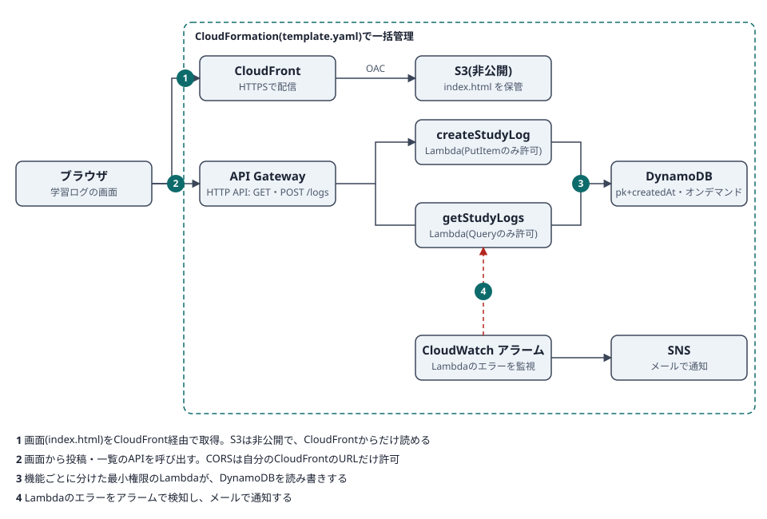

# 学習ログ(AWSサーバーレス投稿アプリ)

「今日やったこと」を投稿して、みんなの学習ログを新しい順に一覧できる小さなWebアプリです。
サーバーレス構成の理解を深めるために、設計から構築、IaC化まで自分の手で作りました。

## 使用しているAWSサービス

| 役割 | サービス |
| --- | --- |
| 画面の配信 | S3(非公開)+ CloudFront |
| API | API Gateway(HTTP API)|
| 処理 | Lambda(Python 3.13)× 2本 |
| データ保存 | DynamoDB(オンデマンド)|
| 監視・通知 | CloudWatch アラーム + SNS(メール)|
| 構築の自動化 | CloudFormation |

## 設計のポイント

**DynamoDBのキー設計**
パーティションキーを固定値 `LOG`、ソートキーを投稿時刻 `createdAt`(ISO形式)にしています。
Scanではなく Query で「新しい順に最新50件」を取得でき、データが増えても読み取りが効率的です。

**Lambdaの権限を機能ごとに分離**
投稿用は `dynamodb:PutItem` のみ、取得用は `dynamodb:Query` のみを許可しています。
どちらも対象は、このアプリのテーブルだけに絞っています(最小権限)。

**S3は非公開、CloudFront経由だけで公開**
Origin Access Control(OAC)を使い、CloudFrontからのアクセスだけS3の読み取りを許可しています。

**CORSを自分のサイトだけに限定**
APIのCORSは、このスタックのCloudFrontのURLだけを許可しています。

**入力チェック**
投稿用Lambdaで、必須項目・文字数(名前30字、内容500字)・JSONの形式を検証し、不正な入力は400で返します。

**エラーの検知**
Lambda 2本それぞれのエラー数を CloudWatch アラームで監視し、1件でも出たらSNS経由でメール通知します。

**すべてコードで再現可能**
`template.yaml`(20リソース)で、画面の配信からDBまでを1つのスタックで作成・更新・削除できます。
手動で構築したあとにIaC化し、変更セットで差分を確認してからスタックを更新しました。

## コスト

すべて従量課金のサービスで構成しています。個人利用の規模では、ごく少額に収まる見込みです。
念のため、AWS Budgetsで月額5USDの予算アラートを設定しています。

## デプロイ手順

1. CloudFormationで、`template.yaml` から新しいスタックを作成する
   - パラメータ `AlarmEmail`:エラー通知を受け取るメールアドレス
   - IAMリソースの作成を承認する
2. SNSから届く確認メールで「Confirm subscription」をクリックする
3. スタックの出力から `ApiUrl` を控え、`index.html` の `API_URL` に書き換える
4. 出力の `BucketName` のバケットに、`index.html` をアップロードする
5. 出力の `SiteUrl` をブラウザで開く

削除するときは、先に `BucketName` のバケットの中身を空にしてから、スタックを削除します。

## ハマったポイントと学び

- **IAMポリシーのリソースARNが、テーブル名と違っていた**
  ハイフン(`study-logs`)とアンダースコア(`study_logs`)を取り違え、`AccessDeniedException` になりました。
  ポリシーを直すと今度は `ResourceNotFoundException` になり、別のテーブル名でテーブルを作っていたことに気づきました。
  エラー文の「何が」「どのリソースに」が書かれた部分を読むと、原因を特定しやすいと学びました。
- **HTMLをファイルとして直接開くと、CORSエラーになった**
  ブラウザのリクエスト元が `origin 'null'` になるためです。
  CloudFrontで公開したURLから確認する方法に切り替えました。
- **手動構築のあとにIaC化して、変更セットで差分を確認した**
  テーブルが置換(データ消失)にならないかを、実行前に変更セットで確かめられました。

## 今後の改善案

- Cognitoなどによる認証の追加
- ページング(現在は最新50件のみ取得)
- WAFやスロットリングによる、悪用対策
- CI/CDでのテンプレート検証とデプロイ

## ファイル構成

| ファイル | 内容 |
| --- | --- |
| `template.yaml` | CloudFormationテンプレート(全リソース)|
| `index.html` | フロント(HTML + JavaScript 1ファイル)|
| `architecture.svg` | 構成図 |
